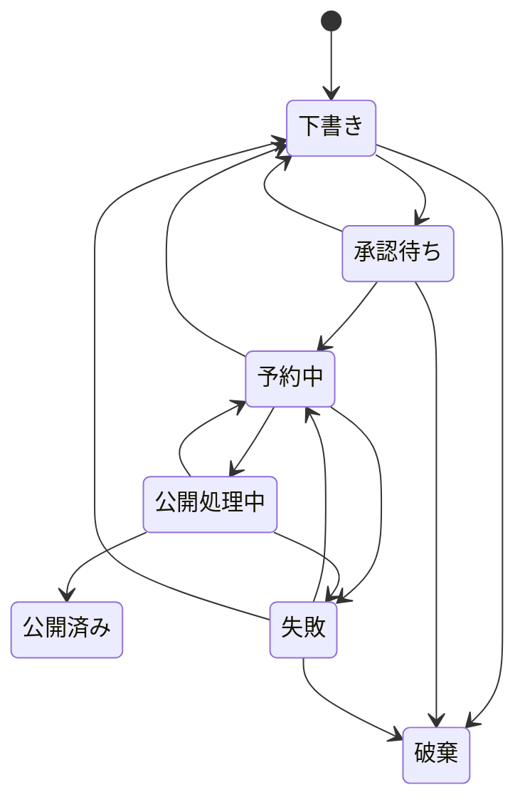
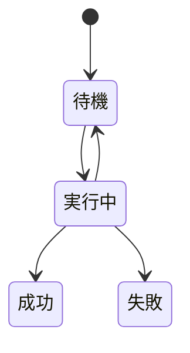
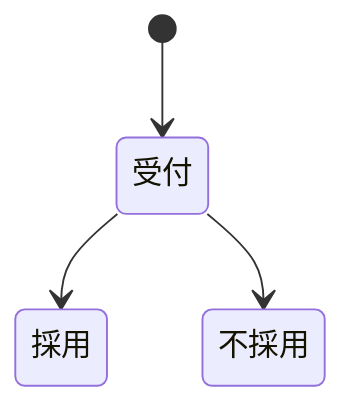

# 全体俯瞰（新島info投稿運用）

> 生成: `harness overview` / 2026-11-03。手で編集しない（用語集・要件・テストから再生成する）。

## 進捗

- 工程: **04 実装（/p4-impl）**
- 要件: 5 / 7 承認
- 受入基準: 92 / 110 がテストで検証済み（84%）
- 非機能要件（テスト検証）: 17 / 19
- 用語: 87 / ドメインの型: 72
- 整合性: エラー 0 / 警告 12

## ドメインモデル

```mermaid
classDiagram
  class InstagramConnection["Instagram連携"] {
    <<コト aggregate>>
    +更新が必要かを判断する（トークン有効期限による）()
    +警告が必要かを判断する()
    +新しいトークンで更新される（更新の記録を追記）()
    +連携し直される（前の連携は同時に解除し、1団体に1つを保つ）()
    +解除される（団体の未解除の連携をすべて解除する）()
  }
  class Post["投稿"] {
    <<コト aggregate>>
    +承認を依頼する()
    +承認する（予約日時を確定し予約中にする。REQ-007 から、最後のスライドに載せる過去の投稿の表紙は選ばない。載せる画像は投稿の版が使った投稿の型の設定の版で決まっている）()
    +修正指示を受ける（下書きに戻す）()
    +予約を取り消す()
    +公開を始める／公開済みになる／失敗する()
    +再実行する（失敗から予約中に戻す）()
  }
  class PostEvent["投稿履歴"] {
    <<コト event>>
  }
  class Job["ジョブ"] {
    <<コト entity>>
    +実行権を取得する（期限付き）()
    +成功する／失敗する／再試行に回る()
  }
  class BatchHeartbeat["バッチ稼働記録"] {
    <<コト event>>
  }
  class BackgroundPhotoAdoption["背景写真としての採用"] {
    <<コト event>>
  }
  class Generation["生成"] {
    <<コト event>>
  }
  class LlmUsage["LLM利用回数"] {
    <<コト aggregate>>
    +1回分を確保する（上限到達なら拒否）()
    +上限に近いか判断する()
  }
  class Idea["ネタ"] {
    <<コト entity>>
    +投稿に使われた／見送られた()
  }
  class PrSubmission["PR入稿"] {
    <<コト aggregate>>
    +採用する／不採用にする()
  }
  class InsightSnapshot["インサイト"] {
    <<コト event>>
  }
  class ImageGeneration["画像生成"] {
    <<コト event>>
    +候補を作る（成功）／失敗する()
  }
  class CandidateAdoption["候補の採用"] {
    <<コト event>>
  }
  class MaterialAdoption["素材画像としての採用"] {
    <<コト event>>
  }
  class ImageGenerationUsage["画像生成の回数"] {
    <<コト aggregate>>
    +1回分を確保する（上限到達なら拒否）()
    +上限に近いか判断する（8割）()
  }
  class Tenant["団体"] {
    <<ヒト entity>>
    +利用するLLMのモデル名・LLM上限・公開猶予を設定として返す()
  }
  class Member["メンバー"] {
    <<ヒト entity>>
    +ロールに従って操作できるかを判断する()
  }
  class Template["テンプレート"] {
    <<モノ entity>>
    +スライドを描く（強調する語は赤字にする。フォントと画像の読み込みを待ってから終わる）()
  }
  class BackgroundPhoto["背景写真"] {
    <<モノ entity>>
    +候補になるか返す（「使わない」にした記録が無いときだけ）()
    +生成の指示から説明文の初めの値を作る（改行を空白にまとめ、先頭100文字に切る）()
  }
  class PostStyleSettings["投稿の型の設定"] {
    <<モノ entity>>
    +表紙の対象の候補に含まれるか判断する()
    +キャプションの定型を返す()
    +固定ハッシュタグを返す()
    +最後のスライドの画像一覧を返す（TS・Java）()
  }
  class PromptVersion["プロンプト版"] {
    <<モノ entity>>
  }
  class NewsSource["ニュースソース"] {
    <<モノ entity>>
  }
  class Role["ロール"] {
    <<kubun>>
    +承認・予約の確定ができるか（ADMIN, APPROVER）()
    +メンバーを追加・削除（無効化）・ロール変更できるか（APPROVER, ADMIN。運用は新島info側の承認者が担う。管理者ロールの付与・変更は ADMIN のみ）()
    +テンプレート・プロンプト版・Instagram連携・投稿の型の設定・管理者が登録する背景写真を管理できるか（ADMIN）()
    +AI が作った背景を背景写真として採用できるか（全ロール。REQ-006）()
    +下書きの作成・編集・承認依頼ができるか（全ロール）()
  }
  class AccessToken["アクセストークン"] {
    <<value>>
  }
  class TokenExpiry["トークン有効期限"] {
    <<value>>
    +残り日数を返す()
    +更新が必要か（残り30日以下。要確認）()
    +警告が必要か（残り14日以下。要確認）()
    +意図的にワークフローを失敗させるか（残り7日以下かつ更新失敗。要確認）()
  }
  class PostRevision["投稿の版"] {
    <<value>>
    +写真風の生成画像を含むか返す（投稿画像一覧かスライド構成に委ねる）()
    +承認時の確認が要るか返す（同上）()
    +公開用キャプションを作る（投稿の型の設定の版・AI生成の表示とあわせて）()
    +下書き案の文言を取り込んだ新しい版を返す（スライド構成に委ねる。素材画像・背景写真・帯の色（アクセント色）・PR区分は保つ。修正指示の再生成で使う。AI が別の色を返しても、人が選んだ帯の色を保つ。REQ-006）()
    +公開用画像が何枚になるか返す（投稿画像一覧の枚数か、スライド構成の枚数）()
    +公開用画像の準備のしかたを返す（アップロードの投稿は公開用の保存先への複製、テンプレートの投稿は画像化）()
  }
  class RevisionContent["投稿の版の中身"] {
    <<value>>
    +公開用画像が何枚になるか返す（投稿画像の枚数／スライドの枚数）()
    +公開用画像の準備のしかたを返す（複製／画像化）()
    +写真風の生成画像を含むか・承認時の確認が要るか返す()
    +公開用キャプションに足すキャプションの定型とハッシュタグを返す（写真の投稿は無し）()
  }
  class PastPostCover["過去の投稿の表紙"] {
    <<value>>
  }
  class PostFormat["投稿種別"] {
    <<kubun>>
    +投稿画像の枚数範囲を返す（画像=1枚、カルーセル=2〜10枚。テンプレートの投稿はスライド構成が3〜10枚なので常にカルーセル）()
    +Instagramへの公開手順を選ぶ（カルーセルは子コンテナを先に作る）()
  }
  class PostMedia["投稿画像"] {
    <<value>>
    +アスペクト比を返す()
  }
  class PostMediaList["投稿画像一覧"] {
    <<collection>>
    +枚数が投稿種別の範囲内かを判断する()
    +1枚目のアスペクト比を返す()
  }
  class ImageSpec["画像仕様"] {
    <<rule>>
    +画像が仕様を満たすか判断し、満たさない項目を返す()
  }
  class Caption["キャプション"] {
    <<value>>
    +含まれるハッシュタグを数える()
  }
  class PublishCaption["公開用キャプション"] {
    <<value>>
    +組み立てる（材料は 投稿の版・投稿の型の設定の版・AI生成の表示）()
    +上限を超えるとき、違反の説明を返す（付けた「PR表記」「AI生成の表示」の名前をこの順に「と」でつなぎ文字数を添える。どちらも無いテンプレートの投稿は「キャプションの定型とハッシュタグを含めて…」。文字数の違反とハッシュタグの数の違反は別々に尋ねられる）()
    +キャプションに使える残りの文字数を返す（下書き案の生成時の検査と人の書き換えに使う）()
  }
  class Hashtag["ハッシュタグ"] {
    <<value>>
  }
  class PrCategory["PR区分"] {
    <<kubun>>
    +公開用キャプションにPR表記を付ける（PR案件のみ。表記の文言は要確認）()
    +PR表記が必要かを返す()
  }
  class ScheduledAt["予約日時"] {
    <<value>>
    +公開してよい時刻になったか判断する()
    +公開猶予を過ぎたか判断する（公開猶予に委ねる）()
  }
  class PublishGrace["公開猶予"] {
    <<rule>>
    +予約日時と現在時刻から、自動公開してよいかを判断する()
  }
  class PostStatus["投稿状態"] {
    <<state>>
    +遷移できるか判断する()
    +編集できるか（下書きのみ）()
    +カレンダーでの色区分を返す()
    +承認の記録で描くか（予約中・公開処理中・公開済み・失敗。最後のスライドの画像を投稿履歴（承認）の記録から作るかの判断。REQ-007。破棄は、失敗のあとに破棄した投稿でも含めない＝公開されないので、表示は記録した設定の版で描けば足りる）()
  }
  class PublishResult["公開結果"] {
    <<value>>
  }
  class FailureReason["失敗理由"] {
    <<value>>
    +画像化の失敗の説明を作る（失敗区分の対処方法＋詳細。「今すぐ再実行」では直らない失敗は、対処方法を付けず詳細だけ。REQ-007 BR-007-06）()
  }
  class FailureKind["失敗区分"] {
    <<kubun>>
    +同じジョブ内で自動リトライしてよいか（TRANSIENT, RATE_LIMITED のみ）()
    +画面に出す対処方法を返す()
  }
  class JobType["ジョブ種別"] {
    <<kubun>>
    +最大試行回数を返す()
    +実行期限（ロックの長さ）を返す()
  }
  class JobStatus["ジョブ状態"] {
    <<state>>
  }
  class Alert["警告"] {
    <<kubun>>
    +重要度（エラー／注意）を返す()
    +表示文言と対処リンクを返す()
  }
  class Slide["スライド"] {
    <<value>>
    +画像化に必要な画像の参照の一覧を返す（実際にあるかは画像化の側で確かめ、無ければ画像化の失敗）()
    +写真風の生成画像を含むか返す（中身に委ねる）()
  }
  class SlideRole["スライド役割"] {
    <<kubun>>
    +使うテンプレートを返す()
    +並び順を返す（表紙 → 中のスライド → 最後のスライド）()
  }
  class SlideList["スライド構成"] {
    <<collection>>
    +満たさない条件を列挙する（AI の出力にも、人が中のスライドを足し引きしたときにも同じ検査をかける）()
    +中のスライドを足す・外す（並びと枚数の条件を守る）()
    +下書き案の文言を取り込む（各スライドの素材画像・表紙の背景写真は保つ）()
    +写真風の生成画像を含むか・承認時の確認が要るか返す（各スライドに委ねる）()
    +各スライドの文言の違反を列挙する（表紙の文言・スライドの文言に委ねる。保存と承認の依頼の前に人の書き換えを確かめる）()
    +位置から、中のスライドの何枚目かを返す()
  }
  class CoverContent["表紙の中身"] {
    <<value>>
    +背景写真を選び直した新しい中身を返す()
  }
  class BodyContent["中のスライドの中身"] {
    <<value>>
    +素材画像を差し替えた・作った新しい中身を返す()
    +写真風の生成画像を含むか返す（素材画像に委ねる）()
  }
  class ClosingContent["最後のスライドの中身"] {
    <<value>>
    +最後のスライドの画像一覧から作る（TS・Java。プレビューと画像化）()
    +投稿履歴（承認）の記録から作る（過去の投稿の表紙が記録されていればそれ、無ければ投稿の型の設定の版の最後のスライドの画像。BR-007-05。TS・Java。画像化と、承認済みの投稿の表示が同じ画像になる）()
    +画像化に必要な画像の参照の一覧を返す（並べる順）()
    +並べる画像が見つからないときの失敗理由を返す（BR-007-06。参照ごとに持つ。ロゴの理由は投稿の型の設定の側。画像化はこれを使うだけで、参照の形を見て分岐しない）（Java だけ）()
  }
  class RenderImageNeed["画像化に必要な画像"] {
    <<value>>
    +見つからないときの画像化の失敗を作る（詳細と、再実行で直るか。直らないもの＝最後のスライドの画像は、失敗理由に対処方法を付けない）()
  }
  class ClosingImage["最後のスライドの画像"] {
    <<value>>
    +'作る前の判断（TS だけ）': 'アップロードした元の画像の大きさから、変換の計画（4:5 の中央を切り抜く範囲・800×1000px まで縮小した保存の大きさ。拡大しない）を返す。切り抜いたあとが 400×500px より小さければ違反を返す（中央の切り抜きの計算は画像仕様の変換の計画と共通にする）'()
    +'作る前の判断（TS だけ）': 'アップロードできる形式（PNG・JPEG）か判断する'()
  }
  class ClosingImageList["最後のスライドの画像一覧"] {
    <<collection>>
    +画像を足す（後ろに入れる。上限なら足せない）（TS だけ。画面の編集）()
    +選び直す（その位置のまま差し替える）（TS だけ）()
    +外す（後ろの画像を前に詰める）（TS だけ）()
    +足せるか返す（TS だけ）()
    +並べる順の画像の参照の一覧を返す（TS・Java）()
  }
  class CoverText["表紙の文言"] {
    <<value>>
    +満たさない条件を列挙する（AI の出力にも人の書き換えにも同じ検査をかける）()
  }
  class SlideText["スライドの文言"] {
    <<value>>
    +満たさない条件を列挙する（AI の出力にも人の書き換えにも同じ検査をかける）()
    +説明文を、強調する部分とそれ以外に分けて返す（テンプレートが赤字に描く）()
    +強調する語の当てはめ結果を、コードポイントの開始位置と長さで返す（保存に使う）()
    +違反を欄（見出し・説明文・強調する語）ごとに返す（画面が欄ごとに赤字で出す）()
  }
  class AccentColor["アクセント色"] {
    <<kubun>>
    +テンプレートで使う色の値を返す（紫・赤・青緑の値は公開中の投稿から読み取ったもの。青・緑・オレンジ・ピンクは設計で決めた値。新しい4色は左端・右端とも白との明るさの比が3:1以上で、これはテストで確かめる。NFR-006-01）()
  }
  class PictureBrief["絵の指示"] {
    <<value>>
    +画像生成の指示を返す()
    +差し替えが必要か返す()
  }
  class MaterialImage["素材画像"] {
    <<value>>
    +生成画像か返す（人が差し替えた画像は生成画像ではない）()
    +AI生成の表示が要るか返す（写真風の生成画像のときだけ）()
  }
  class BackgroundPhotoOrigin["背景写真の出どころ"] {
    <<kubun>>
    +AI が作った背景か返す（元の画像生成を持つか）()
  }
  class BackgroundPhotoList["背景写真一覧"] {
    <<collection>>
    +写真を足せるか判断する（30枚未満）()
    +AI に渡す候補（写真IDと説明文）を返す()
  }
  class CaptionFooter["キャプションの定型"] {
    <<value>>
  }
  class FixedHashtags["固定ハッシュタグ"] {
    <<collection>>
    +AI が足したハッシュタグと合わせ、重複を除いた並びを返す()
  }
  class GenerationInput["生成の入力"] {
    <<value>>
    +プロンプト版に差し込む値を返す()
  }
  class DraftProposal["下書き案"] {
    <<value>>
    +満たさない条件を列挙する（再生成方針に渡す）()
    +プロンプト用途に合わせて調整する（背景写真を選ばない用途なら背景写真を外す、修正なら現在の下書きの PR区分・参照元URL を保ち、中のスライドの枚数が同じか確かめる）()
    +画面から送られた現在の下書きを読む（形と大きさを確かめ、知らない欄を捨てて下書き案の形に整える。文字数の違反は受け付ける）()
  }
  class GenerationRoute["生成経路"] {
    <<kubun>>
    +LLM利用回数を数えるか（APIのみ）()
  }
  class PromptPurpose["プロンプト用途"] {
    <<kubun>>
    +出力のJSONスキーマを返す()
    +AI が背景写真を選ぶ用途か（PLAN のみ）()
    +現在の下書きの特徴（PR区分・参照元URL・中のスライドの枚数）を保つ用途か（REVISE のみ）()
    +手動コピペで取り込める用途か（PLAN・REVISE）()
  }
  class GenerationRetryPolicy["再生成方針"] {
    <<rule>>
    +作り直してよいか判断する（違反があり、まだ作り直しておらず、残り時間が20秒以上）()
    +残り時間を返す()
    +作り直しのときにLLMへ渡す違反の説明を作る()
  }
  class RevisionInstruction["修正指示"] {
    <<value>>
  }
  class LlmQuota["LLM上限"] {
    <<value>>
  }
  class IdeaSource["ネタの出どころ"] {
    <<kubun>>
    +生成した投稿のPR区分の初期値を返す（PR入稿ならPR案件）()
    +PR区分を通常に変えられないか（PR入稿なら変えられない。画面・一括生成・公開直前の3か所で検査する）()
    +参照元URLが必須か()
  }
  class SubmitterContact["入稿者連絡先"] {
    <<value>>
  }
  class SubmissionDecision["採否"] {
    <<state>>
  }
  class AutoCheck["自動チェック"] {
    <<rule>>
    +投稿を検査してチェック結果の一覧を返す()
  }
  class CheckKind["チェック項目"] {
    <<kubun>>
    +重要度を返す（画像仕様違反はエラー、他は注意）()
  }
  class CheckFinding["チェック結果"] {
    <<value>>
  }
  class NgExpression["NG表現"] {
    <<value>>
  }
  class Genre["ジャンル"] {
    <<value>>
  }
  class StandoutPost["伸びた投稿"] {
    <<rule>>
    +公開済み投稿とインサイトから上位N件を選ぶ()
  }
  class ImagePrompt["画像生成の指示"] {
    <<value>>
    +個人を特定できる情報を含むか判断する()
  }
  class ImageStyle["画像の種類"] {
    <<kubun>>
    +生成時に注意書きを出すか（写真風のみ）()
    +承認時に確認表示を出すか（写真風のみ）()
    +公開時にAI生成の表示を付けるか（写真風のみ）()
    +Instagram の AI info（is_ai_generated）を付けるか（写真風のみ）()
  }
  class ImageCandidate["候補"] {
    <<value>>
    +採用されて生成画像になる()
    +放置されたか判断する（画像生成から24時間を過ぎたら、片付けられていなくても消してよい）()
  }
  class AdoptableCandidate["採用できる候補"] {
    <<rule>>
    +自団体の成功した画像生成の、候補の数以内の位置か判断する（撮った写真や他団体の画像が生成画像に化けない）()
  }
  class GeneratedImage["生成画像"] {
    <<value>>
    +AI生成の表示が必要かを返す（画像の種類に委ねる）()
  }
  class AiDisclosure["AI生成の表示"] {
    <<rule>>
    +投稿の版から、付けるべきか判断する（写真風の生成画像を投稿画像か素材画像に1枚でも含むとき）()
    +付ける文字列を返す（要らなければ空）()
  }
  class ImageGenerationQuota["画像生成の上限"] {
    <<value>>
  }
  class ImageGenerator["画像生成の提供元"] {
    <<value>>
  }
  Tenant --> Member
  Tenant --> InstagramConnection
  Tenant --> LlmQuota
  Tenant --> PublishGrace
  Member --> Role
  InstagramConnection --> AccessToken
  InstagramConnection --> TokenExpiry
  Post --> PostRevision
  Post --> PostFormat
  Post --> PublishCaption
  Post --> ScheduledAt
  Post --> PostStatus
  Post --> PostEvent
  Post --> PublishResult
  Post --> FailureReason
  PostRevision --> PostMediaList
  PostRevision --> SlideList
  PostRevision --> Template
  PostRevision --> Caption
  PostRevision --> PrCategory
  PostRevision --> PostStyleSettings
  RevisionContent --> PostRevision
  RevisionContent --> PostMediaList
  RevisionContent --> SlideList
  RevisionContent --> Template
  RevisionContent --> PostStyleSettings
  PastPostCover --> Post
  PastPostCover --> PublishResult
  PastPostCover --> PostMedia
  PastPostCover --> ClosingContent
  PastPostCover --> ClosingImage
  PostMedia --> ImageSpec
  Caption --> Hashtag
  Caption --> PublishCaption
  PublishCaption --> PrCategory
  PublishCaption --> AiDisclosure
  PublishCaption --> CaptionFooter
  PublishCaption --> FixedHashtags
  PublishCaption --> PostRevision
  PostEvent --> PostStatus
  PostEvent --> Member
  FailureReason --> FailureKind
  FailureReason --> RenderImageNeed
  Job --> JobType
  Job --> JobStatus
  Job --> Post
  Template --> Slide
  Template --> SlideRole
  Template --> PostStyleSettings
  Slide --> SlideRole
  Slide --> CoverContent
  Slide --> BodyContent
  Slide --> ClosingContent
  SlideList --> Slide
  SlideList --> SlideRole
  SlideList --> DraftProposal
  CoverContent --> CoverText
  CoverContent --> BackgroundPhoto
  BodyContent --> SlideText
  BodyContent --> PictureBrief
  BodyContent --> MaterialImage
  ClosingContent --> ClosingImage
  ClosingContent --> ClosingImageList
  ClosingContent --> PostStyleSettings
  RenderImageNeed --> ClosingContent
  RenderImageNeed --> Slide
  RenderImageNeed --> PostStyleSettings
  ClosingImage --> ClosingImageList
  ClosingImage --> PostStyleSettings
  ClosingImageList --> PostStyleSettings
  CoverText --> AccentColor
  CoverText --> PostStyleSettings
  SlideText --> Slide
  PictureBrief --> ImagePrompt
  PictureBrief --> MaterialImage
  MaterialImage --> GeneratedImage
  MaterialImage --> MaterialAdoption
  BackgroundPhoto --> BackgroundPhotoList
  BackgroundPhoto --> BackgroundPhotoOrigin
  BackgroundPhoto --> BackgroundPhotoAdoption
  BackgroundPhoto --> Tenant
  BackgroundPhotoOrigin --> BackgroundPhotoAdoption
  BackgroundPhotoAdoption --> ImageCandidate
  BackgroundPhotoAdoption --> GeneratedImage
  BackgroundPhotoAdoption --> AdoptableCandidate
  BackgroundPhotoAdoption --> Member
  PostStyleSettings --> CaptionFooter
  PostStyleSettings --> FixedHashtags
  PostStyleSettings --> Tenant
  CaptionFooter --> Caption
  FixedHashtags --> Hashtag
  GenerationInput --> Idea
  GenerationInput --> PromptVersion
  GenerationInput --> DraftProposal
  GenerationInput --> RevisionInstruction
  DraftProposal --> Caption
  DraftProposal --> PrCategory
  DraftProposal --> PictureBrief
  DraftProposal --> PublishCaption
  DraftProposal --> PromptPurpose
  Generation --> PromptVersion
  Generation --> GenerationRoute
  Generation --> DraftProposal
  Generation --> RevisionInstruction
  PromptVersion --> PromptPurpose
  LlmUsage --> LlmQuota
  Idea --> IdeaSource
  PrSubmission --> SubmitterContact
  PrSubmission --> SubmissionDecision
  PrSubmission --> Idea
  AutoCheck --> CheckKind
  AutoCheck --> CheckFinding
  InsightSnapshot --> Post
  ImageGeneration --> ImagePrompt
  ImageGeneration --> ImageStyle
  ImageGeneration --> ImageCandidate
  ImageGeneration --> ImageGenerator
  ImageGeneration --> ImageGenerationUsage
  ImagePrompt --> SubmitterContact
  ImageStyle --> GeneratedImage
  ImageStyle --> AiDisclosure
  ImageCandidate --> CandidateAdoption
  ImageCandidate --> GeneratedImage
  CandidateAdoption --> GeneratedImage
  CandidateAdoption --> Post
  CandidateAdoption --> Member
  CandidateAdoption --> AdoptableCandidate
  MaterialAdoption --> ImageCandidate
  MaterialAdoption --> GeneratedImage
  MaterialAdoption --> PostRevision
  MaterialAdoption --> AdoptableCandidate
  AdoptableCandidate --> ImageGeneration
  GeneratedImage --> PostMedia
  AiDisclosure --> GeneratedImage
  AiDisclosure --> Caption
  AiDisclosure --> PrCategory
  ImageGenerationUsage --> ImageGenerationQuota
  ImageGenerationUsage --> Tenant
  ImageGenerator --> Tenant
```

## コトと約束

| コト | 約束すること | 約束しないこと |
|---|---|---|
| Instagram連携 | アクセストークンは暗号化して保持し、画面・ログ・LLMに出さない トークン有効期限の残りを毎日確認し、更新できるものは更新する | Instagramアカウント本体のパスワードを預かること 連携が切れている間の投稿を後から自動で取り戻すこと（失敗として記録し人が再実行する） |
| 投稿 | 承認された投稿の版の内容だけを公開する（承認後に設定・テンプレートが変わっても、承認した版が使った版で公開する） PR区分がPRの投稿は、キャプションの先頭にPR表記を必ず付けて公開する 公開の成否と失敗理由を投稿履歴に記録する 同じ投稿を二重に公開しない | 予約日時ぴったりの公開（定期処理の間隔15分の範囲で遅れる） 公開猶予を過ぎた投稿の自動公開（失敗として人に判断を戻す） 公開後の内容の編集（Instagram側で行う） |
| 投稿履歴 | 誰が・いつ・何をしたかを残す | 記録の変更・削除 |
| ジョブ | 同じ仕事は同時に1つの処理しか実行しない 実行期限を過ぎた実行中ジョブは再実行可能に戻す | 実行時刻ぴったりの開始 |
| バッチ稼働記録 | 定期処理の開始と終了を記録する | 個々のジョブの成否の記録（ジョブで行う） |
| 背景写真としての採用 | どの画像生成のどの候補を、誰がいつ背景写真にしたかを残す 採用できる候補で、候補の画像がまだ残っている（片付けられていない）もの、画像の種類が背景・イラストのものだけを受け付ける。同じ候補を二重に背景写真にしない（もう一度要求されたら、すでにある背景写真を返す） 候補の画像を背景写真の保存先に複製してから記録する（画面が渡した画像は信用しない） 背景写真が30枚に達していたら受け付けない（同時に登録されても超えない） | 採用を取り消したことの記録（使わなくするのは「使わない」にした出来事で表す） |
| 生成 | 入力と出力をそのまま残し、品質改善と分析に使えるようにする 入稿者連絡先などの個人情報を入力に含めない | 出力内容の事実性の保証（人の承認で担保する） |
| LLM利用回数 | 呼び出し前に1回分を確保し、上限を超える呼び出しをさせない | Google側の実際の残量との一致（自前の数え方で控えめに止める） |
| ネタ | 出どころと、ニュースなら参照元URLを必ず残す | 投稿になることの保証（使うかは人が決める） 公式サイトの文章・画像の保持（事実だけを持つ） |
| PR入稿 | 採用したらネタ（出どころ=PR入稿）を作る 入稿者連絡先をLLMに渡さない | 掲載や希望日どおりの公開の保証（採否は承認者が決める） |
| インサイト | 1投稿1日1件、追記で残す | Instagram側が後から補正した数値の遡り反映 |
| 画像生成 | 指示・英訳した指示・画像の種類・提供元とモデル名・結果（成功／失敗）・作った候補の数・依頼したメンバー・日時を残す 個人情報を含む指示は提供元に送らず、記録もしない | 作った画像が事実を写していることの保証（写真風はイメージ写真としてだけ使う） 採用されなかった候補の画像を残すこと |
| 候補の採用 | どの画像生成のどの候補を、どの投稿（の版の投稿画像）に、誰がいつ入れたかを残す 採用できる候補だけを受け付ける | 採用を取り消したことの記録（投稿画像から外すのは投稿の版の変更で表す） 投稿を一度も保存しなかった候補の記録（採用されなかったことになる） |
| 素材画像としての採用 | どの画像生成のどの候補を、どの投稿（の版のスライド）に、誰がいつ入れたかを残す 採用できる候補だけを受け付ける | 採用を取り消したことの記録（素材画像を外すのは投稿の版の変更で表す） |
| 画像生成の回数 | 画像生成の前に1回分を確保し、上限を超える画像生成をさせない | 提供元側の実際の残量との一致（自前で控えめに数える） |

### 状態遷移: 投稿状態

### 状態遷移: ジョブ状態

### 状態遷移: 採否

## 要件とテストの対応

| 要件 | 状態 | 受入基準 | テスト |
|---|---|---|---|
| REQ-001 予約投稿が確実に動く土台（フェーズ1） | 承認 | AC-001-01 「利用が許可されていません」と表示され、どのデータも読めない | ✅ |
|  |  | AC-001-02 AC-001-01 と同じ扱いになる | ✅ |
|  |  | AC-001-03 連携中のIGユーザー名とトークン有効期限が表示され、アクセストークンは画面・AP | ✅ |
|  |  | AC-001-04 幅1440以下のJPEG・8MB以下に変換され、アスペクト比は1.91:1〜4: | ✅ |
|  |  | AC-001-05 4:5に中央トリミングされる（トリミング位置は画面で調整できる） | ✅ |
|  |  | AC-001-06 2枚目も4:5にそろえられる | ✅ |
|  |  | AC-001-07 1枚と11枚は「カルーセルは2〜10枚です」で拒否、2枚と10枚は受け付ける | ✅ |
|  |  | AC-001-08 2,200文字は保存でき、2,201文字とハッシュタグ31個はエラー | ✅ |
|  |  | AC-001-09 公開用キャプションが2,201文字になるため「PR表記を含めて2,200文字以内 | ✅ |
|  |  | AC-001-10 操作できない（ボタンが出ず、APIも403相当で拒否） | ✅ |
|  |  | AC-001-11 過去と366日後は拒否、現在+1分は受け付ける | ✅ |
|  |  | AC-001-12 投稿が公開され、投稿状態は公開済み、メディアIDとパーマリンクが記録される | ✅ |
|  |  | AC-001-13 公開されず、失敗（公開猶予切れ）になる | ✅ |
|  |  | AC-001-14 実行権を取れるのは1つだけで、Instagramへの公開APIは1回しか呼ばれな | ✅ |
|  |  | AC-001-15 コンテナの状態を確認し、公開済みならメディアIDを取得して公開済みに、未公開なら | ✅ |
|  |  | AC-001-16 公開済みになり、ジョブの試行結果に同じ試行内の再試行が2回と記録される | ✅ |
|  |  | AC-001-17 リトライせず失敗（連携切れ）になり、失敗理由に「Instagram連携をやり直し | ✅ |
|  |  | AC-001-18 予約中に戻り、次の定期処理で公開される | ✅ |
|  |  | AC-001-19 31日は更新しない、30日は更新して有効期限が延びる | ✅ |
|  |  | AC-001-20 ワークフローが失敗状態で終了し、ログイン時に「トークン更新失敗」の警告が出る | ✅ |
|  |  | AC-001-21 「定期処理が止まっています」の警告が出る | ✅ |
|  |  | AC-001-22 状態ごとに色分けされ、失敗の投稿には理由と再実行ボタンが出る | ✅ |
|  |  | AC-001-23 編集者の招待はできる。管理者ロールは選択肢に出ず、RPCでも拒否される | ✅ |
|  |  | AC-001-24 自分の行には操作が出ず、RPCでも「自分自身のロールは変えられません」「最後の管 | ✅ |
| REQ-002 AIで下書き（画像・キャプション）を生成する（フェーズ2） | 承認 | AC-002-01 文字列としてそのまま表示され、スクリプトは実行されない | ✅ |
|  |  | AC-002-02 1080×1350のJPEGが4枚、承認した版の内容で生成され、公開用ストレージ | ✅ |
|  |  | AC-002-03 表紙 → 中のスライド3枚 → 最後のスライド の順に並んだプレビューと、組み立 | ✅ |
|  |  | AC-002-04 「生成に失敗しました。手動コピペで続けられます」と表示され、生成は失敗として記録 | ✅ |
|  |  | AC-002-05 文言だけが新しくなり、差し替えた素材画像と選び直した背景写真はそのまま。生成とし | ✅ |
|  |  | AC-002-06 79回なら警告なしで生成、80回・99回なら生成して「生成上限が近い」警告（10 | ✅ |
|  |  | AC-002-07 どこが不正かを表示し、下書き案にしない。LLM利用回数は増えない | ✅ |
|  |  | AC-002-08 版4が作られて有効になり、版3は無効として残る。以後の生成は版4を記録する | ✅ |
|  |  | AC-002-09 Geminiへのリクエスト本文に入稿者連絡先（メールアドレス・担当者名）が含まれ | ✅ |
|  |  | AC-002-10 コード変更なしに新しいモデル名で呼ばれ、LLM利用回数はモデルごとに数えられる | ✅ |
|  |  | AC-002-11 12文字・8文字は受け付け、13文字・9文字・対象「同志社」・色「緑」は違反とし | ✅ |
|  |  | AC-002-12 120文字・3か所は受け付けて強調する語を赤字で描く。121文字・4か所・説明文 | ✅ |
|  |  | AC-002-13 その説明文の「11/3」に「ネタに無い情報」の注意が出る。ネタにある日付・金額・ | ✅ |
|  |  | AC-002-14 カードに差し替えた画像が載る。差し替えた画像は生成画像ではなく、背景・イラストの | ✅ |
|  |  | AC-002-15 0件なら過去の投稿の欄が無い、1件なら1件、5件なら承認時点で公開日時が新しい2 | ✅ |
|  |  | AC-002-16 0枚なら表紙は紺の単色の背景、3枚ならそのうち1枚が選ばれ、人が別の1枚に選び直 | ✅ |
|  |  | AC-002-17 本文 → 定型 → | ✅ |
|  |  | AC-002-18 2,200文字は受け付け、2,201文字は「PR表記とAI生成の表示を含めて2, | ✅ |
|  |  | AC-002-19 候補の採用がそのスライドに結び付けて記録され、承認時に「写真風の生成画像を含みま | ✅ |
|  |  | AC-002-20 REQ-005 と同じ文言が出て画像生成されず、そのスライドは文字だけのカードの | ✅ |
|  |  | AC-002-21 絵の指示に「Spotify」は含まれず、そのスライドに「差し替えが必要」の印が出 | ✅ |
|  |  | AC-002-22 どちらも保存できず、違反の理由が出る。LLM利用回数は増えない | ✅ |
|  |  | AC-002-23 投稿は失敗（画像化の失敗）になり、理由が表示される。「今すぐ再実行」でやり直せる | ✅ |
|  |  | AC-002-24 消えずに「使わない」になり、以後の候補から外れる。その投稿の画像化には使える | ✅ |
| REQ-003 ネタ箱・AI企画・自動チェック・承認フロー・PR入稿（フェーズ3） | draft | AC-003-01 ネタ（出どころ=運営メモ）が登録され、一覧の先頭に出る | — |
|  |  | AC-003-02 どちらもエラーで登録されない | — |
|  |  | AC-003-03 伸びた投稿の上位3件を例に含めて生成し、スライド構成・キャプション・ハッシュタグ | — |
|  |  | AC-003-04 「PR案件の可能性があります。PR区分を確認してください」が注意として出る。PR | — |
|  |  | AC-003-05 「日付と曜日が合っていません（11月3日は月曜日）」が注意として出るが、承認はで | — |
|  |  | AC-003-06 NG表現の注意が出る | — |
|  |  | AC-003-07 投稿は下書きに戻り、修正指示を入力に再生成された下書き案が付く | — |
|  |  | AC-003-08 予約中になり、テンプレート利用の投稿なら画像生成ジョブが作られる | — |
|  |  | AC-003-09 受け付けず、何も保存されない | — |
|  |  | AC-003-10 「受け付けました」と表示され、採否=受付で保存される。入稿者連絡先は編集者には表 | — |
|  |  | AC-003-11 採否=採用になり、ネタ（出どころ=PR入稿）ができる。そこから作る投稿のPR区分 | — |
|  |  | AC-003-12 受け付けない（1時間5件まで。要確認） | — |
| REQ-004 ネタ収集と効果分析（フェーズ4） | draft | AC-004-01 ネタは1件だけ増え、参照元URLが入っている | — |
|  |  | AC-004-02 そのソースだけ失敗を記録し、他のソースとジョブ全体は続行する | — |
|  |  | AC-004-03 その日のインサイトが1件追記され、同じ日に再実行しても重複しない | — |
|  |  | AC-004-04 取得しない | — |
|  |  | AC-004-05 0.10, 0.08, 0.05 の順で返る | — |
|  |  | AC-004-06 0除算せず、比率の計算対象から除く | — |
| REQ-005 AIで投稿画像（背景・イラスト・写真風）を生成する | 承認 | AC-005-01 候補が4枚表示される。画像生成として指示・英訳した指示・種類・モデル名・結果「成 | ✅ |
|  |  | AC-005-02 0文字と501文字は「指示は1〜500文字です」で拒否され、1文字と500文字は | ✅ |
|  |  | AC-005-03 「個人を特定できる情報は指示に含められません」で拒否される。Gemini も提供 | ✅ |
|  |  | AC-005-04 2,182文字は受け付け、公開用キャプションは末尾に改行と「※画像はAIで生成し | ✅ |
|  |  | AC-005-05 公開用キャプションにAI生成の表示は付かず、コンテナ作成に is_ai_gene | ✅ |
|  |  | AC-005-06 14回なら警告なしで生成、15回なら生成して「画像生成の上限が近い」警告、19回 | ✅ |
|  |  | AC-005-07 「画像を生成できませんでした」と表示され、作成中の投稿の内容は失われない。画像生 | ✅ |
|  |  | AC-005-08 「写真風の生成画像を含みます。実際の出来事・場所・人の写真として使っていないか、 | ✅ |
|  |  | AC-005-09 「イメージ写真としてだけ使えます。実際の出来事・場所・人を撮ったように見せる使い | ✅ |
|  |  | AC-005-10 2,177文字は受け付け、公開用キャプションは先頭にPR表記、末尾にAI生成の表 | ✅ |
|  |  | AC-005-11 親コンテナの作成に is_ai_generated=true が付く | ✅ |
|  |  | AC-005-12 2枚が画像仕様を満たす投稿画像として投稿画像一覧の末尾に加わり（2枚以上ならカル | ✅ |
|  |  | AC-005-13 25時間前の候補の画像は消え、画像生成の記録は残る。採用の記録は無い。24時間以 | ✅ |
|  |  | AC-005-14 上限のときは Gemini も提供元も呼ばず「いまは画像を作れません。写真を撮る | ✅ |
|  |  | AC-005-15 どちらもできる | ✅ |
|  |  | AC-005-16 コード変更なしに新しいモデル名で呼ばれ、記録にそのモデル名が残る | ✅ |
|  |  | AC-005-17 拒否される（追記のみ） | ✅ |
| REQ-006 AIで作る・表紙の背景画像を生成する／帯の色を7色にする（改修） | 承認 | AC-006-01 7つは受け付ける。黄・水色は違反として1回だけ再生成させる（AC-002-11  | ✅ |
|  |  | AC-006-02 プレビューの帯が選んだ色になり、保存・承認依頼ができる。修正指示の作り直しでも、 | ✅ |
|  |  | AC-006-03 これまでと同じ色・同じ見た目の1080×1350のJPEGになる | ✅ |
|  |  | AC-006-04 背景写真が13枚になり、その写真（出どころ=AI が作った背景）が表紙の背景にな | ✅ |
|  |  | AC-006-05 1文字・500文字は生成できる。0文字・501文字は指示の検査で拒否し、画像生成 | ✅ |
|  |  | AC-006-06 画像の種類は「背景・イラスト」の固定の表示で、「写真風」は選べない。写真風の候補 | ✅ |
|  |  | AC-006-07 29枚なら登録でき30枚になる。30枚なら「AIで作る」を出さず、サーバーに直接 | ✅ |
|  |  | AC-006-08 生成せず、「今日の画像生成は上限に達しました。登録した背景写真から選んでください | ✅ |
|  |  | AC-006-09 登録できる（管理者の画面を通さない）。他団体のメンバーは他団体の候補を採用できな | ✅ |
|  |  | AC-006-10 すべて拒否し、背景写真は増えない | ✅ |
|  |  | AC-006-11 その写真が背景の候補に出て、AI が話題に合うと判断すれば選ばれる。人が選び直す | ✅ |
|  |  | AC-006-12 消えずに「使わない」になり、以後の候補から外れる。その投稿の画像化には使える | ✅ |
|  |  | AC-006-13 AI生成の表示もAI info（is_ai_generated）も承認時の確認表 | ✅ |
|  |  | AC-006-14 投稿は失敗（画像化の失敗）になり、理由が表示される。「今すぐ再実行」でやり直せる | ✅ |
| REQ-007 最後のスライドの画像を設定画面でアップロードする（改修） | 承認 | AC-007-01 投稿の型の設定の新しい版ができ、最後のスライドの画像が2枚（1枚目は中央の 80 | ✅ |
|  |  | AC-007-02 400×500px は 400×500px のまま受け付ける。ほかの3つは「縦5 | ✅ |
|  |  | AC-007-03 「PNG か JPEG を選んでください」と表示し、設定は変わらない | ✅ |
|  |  | AC-007-04 それぞれ新しい版の画像が [B] / [C, B] / 0枚 になる。前の版は  | ✅ |
|  |  | AC-007-05 0枚なら画像の欄が無く、1枚なら真ん中に1枚、2枚なら1枚目が左・2枚目が右に並 | ✅ |
|  |  | AC-007-06 どちらも画像A のまま。承認を依頼した投稿を修正指示で下書きに戻して保存し直すと | ✅ |
|  |  | AC-007-07 プレビューは画像B（保存すると使う最新の版）。保存すると、その下書きの版は版2  | ✅ |
|  |  | AC-007-08 最後のスライドに過去の投稿の表紙は載らない（自動では選ばない）。承認の記録に過去 | ✅ |
|  |  | AC-007-09 2件のものは記録した2件の表紙が載り、0件のものは画像の欄が無い（どちらも設定の | ✅ |
|  |  | AC-007-10 過去の投稿の表紙は載らず、保存した時点の設定の最後のスライドの画像が載る | ✅ |
|  |  | AC-007-11 拒否され、設定は変わらない。他団体のメンバーは画像を見られない | ✅ |
|  |  | AC-007-12 すべて拒否され、設定の新しい版はできない | ✅ |
|  |  | AC-007-13 投稿は失敗（画像化の失敗）になり、「最後のスライドの画像が見つかりません。管理者 | ✅ |
